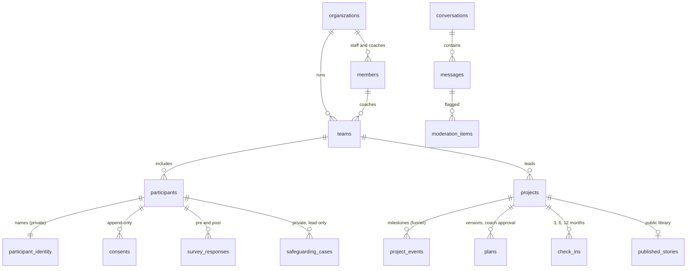

# We Are the Change: data model

The database behind the coach portal, the WhatsApp bot and impact reporting. It runs
on **Supabase** (managed PostgreSQL). The SQL is in `supabase/migrations/`; the tests
are in `supabase/tests/`.

## Design in five rules

1. **Identity is kept apart.** Girls' first names, phone numbers and guardian details
   live in a locked `private` area that the app cannot query directly. Everything
   else refers to a girl only by a random ID.
2. **Every look at identity is logged.** Names are read and written only through two
   checked functions (`team_roster`, `set_participant_identity`). Each call is
   recorded: who, when, which team.
3. **Consent gates contact.** Consent records can be added or withdrawn, never edited
   or deleted. The database refuses to store an outbound WhatsApp message to a girl
   without active participation consent, and withdrawing consent withdraws her.
4. **Each role sees only what its job needs** (table below). The database enforces
   this, not the app, so a bug in the app cannot leak data across teams.
5. **Places stop at the town or district.** There is no field for an address, a school
   or an exact location anywhere.

## What is stored



| Area | Tables | Notes |
| --- | --- | --- |
| People | `organizations`, `members`, `teams` | A member is a role a signed-in adult holds: admin, safeguarding lead, moderator, coach, partner admin or evaluator. Coaches record their background-check date. |
| Girls | `participants`, `private.participant_identity` | Birth year and month only, not full date of birth. Under-13s are always reached through their coach. |
| Consent | `consents` | Participation, media, future contact (for the alumni study), research. Records who gave it, how, and which version of the form. |
| Projects | `projects`, `project_events`, `plans`, `check_ins` | Every milestone is an event, so the funnel and timelines come from one table. |
| Impact | `survey_responses`, `community_observations` | Leadership and confidence surveys before and after; teachers' and community leaders' observations, with no identity stored. |
| Conversations | `conversations`, `messages`, `moderation_items` | Text is stored after contact details are removed. Each message keeps its safety-check result. |
| Safeguarding | `private.safeguarding_cases` | Anyone involved can raise a concern; only the safeguarding lead can read cases. |
| Public library | `published_stories` | The only table the public can read. A story cannot go live until media consent is confirmed. |

## Who can see what

| | Admin | Safeguarding lead | Moderator | Coach | Partner admin | Evaluator | Public |
| --- | --- | --- | --- | --- | --- | --- | --- |
| Teams and projects | All | All | All (context) | Own teams | Own organization | All | No |
| Girls' records (no names) | All | All | No | Own teams | Own organization | All | No |
| Girls' names and phones | Via logged roster | Via logged roster | No | Own teams, via logged roster | Own organization, via logged roster | No | No |
| Consent records | All | All | No | Own teams | Own organization | Read | No |
| Chat messages | Yes | Yes | Yes | No | No | No | No |
| Safeguarding cases | Raise only | Read and manage | Raise only | Raise only | Raise only | No | No |
| Impact funnel | All | All | All | Own teams | Own organization | All | No |
| Published stories | Manage | Read | Read | Read | Read | Read | Read |

Coaches never read raw chat. They see plans, check-ins and progress, while moderation
stays with trained staff.

## Safety gates the database enforces

Tested in `supabase/tests/10_access_and_gates_test.sql` (37 checks):

- Girls register only between 12 and 18.
- A girl under 13 cannot be contacted on her own WhatsApp, and her own number cannot
  be stored.
- A girl cannot be marked active without participation consent.
- No outbound WhatsApp message without active consent, including after withdrawal.
- Consent records cannot be edited or deleted; withdrawal cascades to her status.
- A story cannot be published without confirmed media consent.
- The public can read published stories and nothing else.

## Decisions needed before going live

| Decision | Proposed | Why it matters |
| --- | --- | --- |
| How long chat text is kept | 12 months, then cleared | Needed for moderation and support, not for impact data |
| How long a withdrawn girl's identity is kept | 30 days, then deleted | Her pseudonymous impact data stays |
| Safeguarding case records | Reviewed after 7 years | Practice varies by country; confirm with the safeguarding specialist |
| Hosting region | Closest to most participants (Mumbai, while India leads) | Speed, and comfort for Indian partners under the DPDP Act |
| How guardian consent is verified in each country | Paper form held by the partner, or a WhatsApp confirmation from the guardian's number | India's DPDP Rules require *verifiable* parental consent |
| Who holds the safeguarding lead role, and the deputy | To name | The role sees everything; keep it to two people |

These are in `retention_rules` with `approved = false` until the board signs them off.

## Setting it up

1. Create a Supabase project in Goals for Girls' name (Pro plan, about $25 a month).
2. Install the [Supabase CLI](https://supabase.com/docs/guides/cli), link the project,
   and run `supabase db push`. Or paste the two migration files, in order, into the
   SQL editor.
3. Schedule `private.apply_retention()` to run daily (Supabase Cron).
4. Keep the service-role key on the server only (Vercel environment variables).

## Testing locally

```bash
PGHOST=... PGPORT=... PGUSER=postgres scripts/test-db.sh
```

Creates a scratch database, loads a small Supabase stand-in, runs the migrations and
the tests, then deletes the database. Run it after every change to the migrations.
